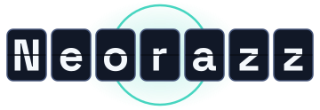
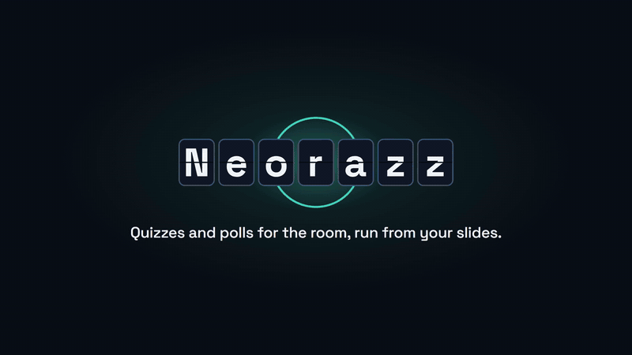

<p align="center">
  
</p>

<p align="center">
  
</p>

## 🧩 What is this project?

Neorazz is a self-hosted, open-source quiz and poll platform for classrooms and talks. A presenter runs it on their own server; the room joins from their phones with a PIN.

It began as a fork of [Razzia](https://github.com/Ralex91/Razzia) by Ralex91 and has changed enough to carry its own name. On top of Razzia's quizzes it adds:

- **Lecture rooms** that hold through a whole lecture: late joiners are let in, and each question is played from its own slide ([ADR 0002](docs/adr/0002-lecture-mode-and-deck-bridge.md)).
- **Embedding**, so a slide deck, a class site or any web app can show the host screen and drive it: open a room, run questions and polls, and set the sound from its own buttons or slides ([guide](docs/embedding.md)).
- **Polls**, sealed by default, with each vote arriving on the shared screen ([ADR 0004](docs/adr/0004-polls-as-a-room-lane.md)).
- **A private question box** that the presenter reads from a drawer while the projector shows only a count ([ADR 0006](docs/adr/0006-asks-a-private-question-lane.md), [ADR 0007](docs/adr/0007-presenter-drawer.md)).
- **A staged show**: a server-clocked answer reveal, a generated score, stage light, and screens spaced for phones through projectors.

Razzia's code is MIT licensed, and so is Neorazz; the original copyright notice is kept in [LICENSE](LICENSE). Inside the code, package names, storage keys and one tag in the embedding protocol still say `razzia`, so existing decks and saved data keep working.

> **Disclaimer**: Neorazz is an independent, open-source software project. It is not affiliated with, endorsed by, or sponsored by any third-party quiz platform or service. Any resemblance to other quiz platforms is purely incidental.

## ⚙️ Prerequisites

Choose one of the following deployment methods:

### Without Docker

- Node.js : version 22.12 or higher
- PNPM : version 11 or higher (learn more [here](https://pnpm.io/))

### With Docker

- Docker and Docker Compose

## 📖 Getting Started

Choose your deployment method:

### 🐳 Using Docker (Recommended)

Neorazz publishes no image yet, so Docker builds it from this checkout. Using Docker Compose ([compose.yml](/compose.yml)):

```bash
git clone https://github.com/insominx/Neorazz.git
cd ./Neorazz
docker compose up -d --build
```

Or using Docker directly:

```bash
docker build -t neorazz:local .
docker run -d \
  -p 3000:3000 \
  -v ./config:/app/config \
  neorazz:local
```

**Configuration Volume:**
The `-v ./config:/app/config` option mounts a local `config` folder to persist your game settings and quizzes. This allows you to:

- Edit your configuration files directly on your host machine
- Keep your settings when updating the container
- Easily backup your quizzes and game configuration

The folder will be created automatically on first run with an example quiz to get you started.

**Quizzes baked into the image:**
An image built from this repository carries the quizzes in `config/quizz` as seed data. On every start, a quiz that is missing from the volume is added, and a seeded quiz that nobody has edited is updated when the committed version changes. A quiz you created or edited in the manager is never overwritten or deleted, even when the committed version differs (the log says so). To drop a quiz, delete it in the manager. The seeder records what it wrote in `.seed-manifest.json` beside `game.json`.

The application will be available at http://localhost:3000

To let your own slides or site drive this host, list their origins in `NEORAZZ_EMBED_ORIGINS` (see [Embed it in your slides or web app](#-embed-it-in-your-slides-or-web-app)).

### 🛠️ Without Docker

1. Clone the repository:

```bash
git clone https://github.com/insominx/Neorazz.git
cd ./Neorazz
```

2. Install dependencies:

```bash
pnpm install
```

3. Build and start the application:

```bash
# Development mode
pnpm run dev

# Production mode
pnpm run build
pnpm start
```

## ⚙️ Configuration

The configuration is split into two main parts:

### 1. Game Configuration (`config/game.json`)

Main game settings:

```json
{
  "managerPassword": "PASSWORD",
  "visuals": {
    "background": {
      "kind": "config-asset",
      "path": "example-background.webp"
    }
  }
}
```

Options:

- `managerPassword`: The master password for accessing the manager interface. **Must be changed from the default `"PASSWORD"` value**, otherwise manager access is blocked.
- `visuals.background`: Optional instance-wide background. The manager's **Visuals** tab uploads PNG, JPEG, WebP, or GIF images up to 5 MB and writes this portable config-asset reference for you.
- `visuals.soundTheme`: Optional sound pack. `show` (default) is the generated score: it follows each round, climbs a semitone per question and answers the room's verdict. `classic` keeps the original quiz loops. A config that still names the removed `techno` pack reads as `show`. The manager's **Visuals** tab can switch this; the pack is snapshotted when a game is created, so switching it never swaps cues under a running game.
- `visuals.showIntensity`: Optional, how big the show is: `full` (default) is everything, with light and sound hits that fill the whole frame; `calm` keeps the picture but drops the full-frame hits, the spotlight and beams, and plays the music 12 dB lower with no groove while answering; `silent` is calm with no audio. The manager's **Visuals** tab sets it, and it is fixed when a game is created. A device set to reduced motion gets calm's visuals either way.

Uploaded files are stored in `config/assets/backgrounds/`. Keep that folder together with `config/game.json` and your quizzes when copying, backing up, or mounting a configuration. The repository ignores `config/` by default, so these files travel with the Docker volume or a copied config directory unless you deliberately change your Git workflow.

This is managed storage: references in `config/game.json` and
`config/quizz/*.json` determine which uploaded backgrounds remain reachable.
Replacing or clearing a reference reclaims the old file after the configuration
commit when no other config still uses it. Runtime cleanup gives uncommitted
uploads a one-hour grace and protects uploads from the current server process;
startup cleanup removes abandoned unreferenced files left by an earlier process.

### 2. Quiz Configuration (`config/quizz/*.json`)

Quizzes can be created in two ways:

- **Via the Quiz Editor** — use the built-in editor available in the manager dashboard (recommended)
  The editor's **Rehearse** button opens a tab that plays the quiz as it is on screen, saved or not, on the projector's and a phone's real screens, with no game and no login. It warns about a question that may not fit the projector.
- **Via JSON files** — manually create files in the `config/quizz/` directory

You can have multiple quiz files and select which one to use when starting a game.

Example quiz configuration (`config/quizz/example.json`):

```json
{
  "subject": "Example Quiz",
  "visuals": {
    "background": {
      "kind": "config-asset",
      "path": "quiz-background.webp"
    }
  },
  "questions": [
    {
      "question": "What is the correct answer?",
      "answers": ["No", "Yes", "No", "No"],
      "solutions": [1],
      "cooldown": 5,
      "time": 15
    },
    {
      "question": "Which of these are primary colors?",
      "answers": ["Red", "Green", "Blue", "Yellow"],
      "solutions": [0, 2, 3],
      "cooldown": 5,
      "time": 20
    },
    {
      "question": "What is the correct answer with an image?",
      "answers": ["No", "Yes", "No", "No"],
      "media": {
        "type": "image",
        "url": "https://placehold.co/600x400.png"
      },
      "solutions": [1],
      "cooldown": 5,
      "time": 20
    }
  ]
}
```

Quiz Options:

- `subject`: Title/topic of the quiz
- `visuals.background`: Optional per-quiz override uploaded from the quiz editor. When omitted, the quiz inherits the global background from `config/game.json`; when neither is configured, the bundled background is used.
- `questions`: Array of question objects containing:
  - `question`: The question text
  - `answers`: Array of possible answers (2-4 options)
  - `media`: Optional media object displayed with the question:
    - `type`: `"image"`, `"video"`, or `"audio"`
    - `url`: URL of the media
  - `solutions`: Array of correct answer indices (0-based). Use multiple indices for multi-answer questions
  - `cooldown`: Time in seconds before answers are revealed (3-15)
  - `time`: Time in seconds allowed to answer (5-120)

Background precedence is **quiz override → global default → bundled fallback**. Neorazz resolves that choice when a game is created and keeps it fixed for the whole live session, including player joins and reconnects. Changing a background affects newly created games, not one already in progress. On play and editor-preview surfaces, the selected image is composited beneath a measured 75% dark scrim that met the documented contrast floor on the four X1 adversarial background fixtures (minimum measured 8.02:1).

## 🎮 How to Play

1. Access the manager interface at http://localhost:3000/manager
2. Enter the manager password (defined in `config/game.json`)
3. Share the game URL (http://localhost:3000) and room code with participants
4. Wait for players to join
5. Click the start button to begin the game

## 📊 Polls

A poll asks the room a question that has no right answer ("What should we do first?") and shows how the room voted. Polls run in a **lecture room**, so students join once, by the name they already gave, and can join late.

### Running one

1. In the manager's **Polls** tab choose **Create poll**: a question, two to six options, whether votes are anonymous (the default) or named, and whether the screen shows results while people vote (it does not, by default).
2. In the **Play** tab pick a quiz and choose **Start lecture room**. A normal game cannot run polls. Students join with the PIN as usual.
3. In the lobby, or on a results or leaderboard screen between questions, choose **Poll** at the top left and pick the poll. Every phone shows it. A tap votes, and another tap changes the vote until you close the poll.
4. Choose **Close poll** to end voting and show everyone the result, then **Done** to go back to the quiz, which carries on exactly as it was. The quiz's controls wait until you press **Done**.

### Sealed or live

A poll is **sealed** unless you turn on **Show results while people vote** when you write it. While a sealed poll is open, the host's screen shows the question, the options and how many have voted ("12 of 25 voted"), but no counts and no bars; they appear when you close the poll. As each person votes, their name lands under the options with a chime, the room's light rises and a heartbeat quickens until everyone is in; their choice is never shown. A **live** poll shows the bars growing as people vote; its arrivals show no name unless the poll is named. Phones see counts only after the close either way. A shared screen invites following the crowd, which is why sealed is the default.

### Anonymity

- **Anonymous** (the default): nobody is shown who voted for what, and no name is saved. In a sealed poll the screen shows each voter's name as they vote (never their choice), and phones say so before the tap. It hides choices, not timing: in a small group, watching the votes arrive one at a time (or kicking a student, whose vote then disappears) can still reveal who voted what. A live poll shows more of this than a sealed one, because the bars move with each vote.
- **Named**: you see each student's name beside their vote, and students are told so. Names also show on the screen as people vote, never beside a choice; in a live named poll the room can match a name to the bar that moves, and phones warn about that. The names are saved in the result.

Whether a poll is named is part of the poll, not chosen at launch.

### From a slide deck or another page

A page that embeds Neorazz (see [Embed it in your slides or web app](#-embed-it-in-your-slides-or-web-app)) can run a poll from its slides: the question and options are the slide's own text, sent when the instructor presses the clicker, and nothing is stored on the server first. The result is saved like any other. The shared screen shows the question and "n of m voted", and in a sealed poll each voter's name as they vote, never beside a choice; the slide shows through behind it. See [ADR 0005](docs/adr/0005-polls-from-a-deck.md).

### Where things are kept

- `config/polls/<id>.json`: the polls you wrote, such as `{ "question": "What first?", "options": ["Review", "New topic"], "anonymous": true }`. Add `"live": true` to show results while people vote; a poll without it is sealed. A question is up to 500 characters; there are 2 to 6 options of up to 200 characters, no two alike. Edit them in the Polls tab or by hand.
- `config/poll-results/<id>.json`: one record for each poll that was run, with the question and options as they were asked, the counts, the quiz the room was for, the date, and names only for a named poll. A poll still open when its room closed is saved as **Ended early**. Open or delete these under **Polls → Results**. They are kept apart from quiz results.

Keep both folders with `config/game.json` and your quizzes when you copy, back up or mount a configuration. The Docker image does not ship any polls.

An open poll lives in the server's memory, so restarting the server loses it along with any live room: do not deploy during a class. Editing or deleting a poll does not change one that is open or a result already saved. The design is recorded in [ADR 0004](docs/adr/0004-polls-as-a-room-lane.md).

## 🖼️ Embed it in your slides or web app

The host screen can sit inside your own page (a slide deck, a class site, any web app), and that page can drive it: open a room, play a question from the slide that asks it, run a poll, show the standings. Players join on their phones as usual.

1. **Allow your site.** Set `NEORAZZ_EMBED_ORIGINS` on the host to your page's origin, for example `https://slides.example.org` (several are separated by commas), and restart it. Pages on `localhost` and `127.0.0.1` are always allowed.
2. **Add the client.** Every host serves it at `/neorazz-embed.js`:

   ```html
   <div id="quiz" style="width: 100%; aspect-ratio: 16 / 9"></div>
   <script src="https://quiz.example.org/neorazz-embed.js"></script>
   <script>
     const quiz = NeorazzEmbed.mount({
       host: "https://quiz.example.org",
       container: document.getElementById("quiz"),
     })
     quiz.ensureGame({ quiz: "my-quiz" })
   </script>
   ```

3. **Drive it** from your buttons or slides: `quiz.play({ question: 0 })`, `quiz.startPoll({ poll })`, `quiz.leaderboard()`, `quiz.finish()`. The presenter types the manager password inside the frame once.

To try it locally, run `pnpm run dev`, serve [`examples/embed/`](examples/embed/) with any static server, and open it with `?host=http://localhost:3000`. The full guide, with the protocol, a slide-deck recipe and troubleshooting, is [docs/embedding.md](docs/embedding.md).

## 📝 Contributing

Contributions are welcome! Please read the [CONTRIBUTING.md](.github/CONTRIBUTING.md) guide before submitting a pull request.

For bug reports or feature requests, please [create an issue](https://github.com/insominx/Neorazz/issues).
